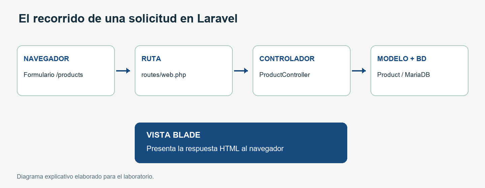
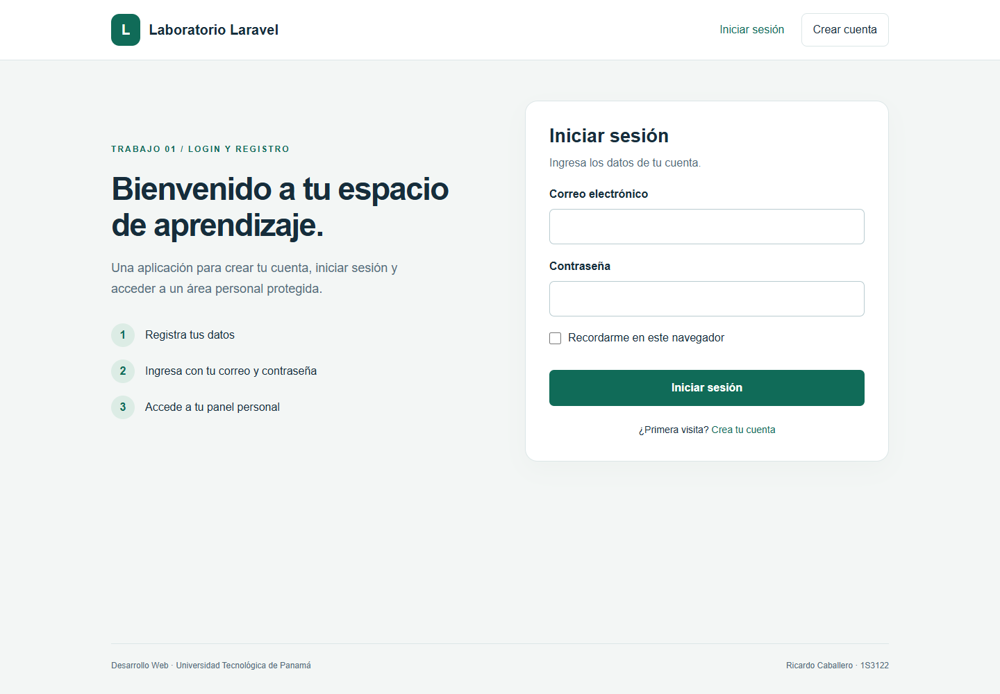

# Trabajo 01 | Login y registro en Laravel

**Estudiante:** Ricardo Caballero  
**Correo académico:** ricardo.caballero5@utp.ac.pa  
**Grupo:** 1S3122  
**Curso:** Desarrollo Web  
**Docente:** Ing. Irina Fong  
**Institución:** Universidad Tecnológica de Panamá, Facultad de Ingeniería de Sistemas Computacionales, Campus Victor Levi Sasso.  
**Fecha de ejecución:** 22 de octubre de 2026.

## Repositorio del trabajo

https://github.com/ricardo-caballero2663/ricardo-caballero-laravel

## Introducción y objetivo

Este trabajo desarrolla una aplicación de autenticación siguiendo la guía de introducción a Laravel. El propósito es comprender la arquitectura Modelo-Vista-Controlador y construir un flujo real de registro, inicio y cierre de sesión con persistencia en MariaDB. La aplicación incluye formularios en español, validación de datos y una página personal que requiere autenticación.

La entrega contiene un proyecto Laravel independiente en `aplicacion/`, capturas reales en `capturas/` y un respaldo SQL en `respaldo/`. La documentación del segundo trabajo se entrega por separado, aunque estudia esta misma experiencia de login.

## Entorno y requisitos

- Windows; PHP 8.3.36 portátil utilizado en la ejecución. Laravel 12 requiere PHP 8.2 o superior.
- Laravel Framework 12.70.1 y laravel/ui 4.6.3, fijados en `composer.lock`.
- Composer, Node.js y npm para instalar dependencias; Bootstrap y Vite para los recursos visuales.
- MariaDB 10.4.32 de XAMPP, en una instancia separada con puerto 3308 y base `lab_login`.
- Servidor PHP de desarrollo en `http://127.0.0.1:18081`. En este montaje no se necesitó Apache.

Se utilizó una instalación portátil compatible porque el PHP disponible en XAMPP era 8.0.30. XAMPP no fue actualizado ni se utilizaron sus bases existentes. Las versiones exactas de los paquetes pueden consultarse en los archivos de bloqueo.

## Arquitectura MVC y organización

El modelo `app/Models/User.php` representa a los usuarios y permite persistirlos con Eloquent. Los controladores de `app/Http/Controllers/Auth/` coordinan el registro y la autenticación. `HomeController` exige una sesión válida para presentar el panel. Las vistas de `resources/views/auth/` muestran los formularios, y `resources/views/home.blade.php` presenta la cuenta activa.

`routes/web.php` relaciona las solicitudes HTTP con sus controladores. `database/migrations/` define las tablas; `config/` contiene la configuración y `.env` los valores del entorno local. `public/` es la raíz que debe atender el servidor web; `vendor/` contiene dependencias instaladas por Composer.



## Desarrollo de la solución

La base del proyecto se creó con Laravel 12 y se instaló el paquete de autenticación indicado en la guía. El scaffold inicial se personalizó en español conservando los controladores de Laravel UI.

```powershell
composer create-project laravel/laravel login-registro "12.*"
cd login-registro
composer require laravel/ui
php artisan ui bootstrap --auth
npm install
npm run build
```

`composer require` registra una dependencia PHP. `ui bootstrap --auth` genera los recursos y controladores de autenticación. `npm install` descarga el frontend; `npm run build` compila CSS y JavaScript y crea `public/build/manifest.json`. No se necesita mantener Vite abierto al usar esa compilación.

### Conexión y migraciones

El archivo `.env.example` permite configurar una instalación nueva sin copiar la clave de la ejecución original. `APP_KEY` se genera para cada instalación. En este laboratorio, la cuenta root sin contraseña se usó únicamente en la instancia local aislada.

```dotenv
APP_NAME="Laboratorio Laravel"
APP_ENV=local
APP_KEY=
APP_DEBUG=true
APP_URL=http://127.0.0.1:18081
APP_LOCALE=es
DB_CONNECTION=mysql
DB_HOST=127.0.0.1
DB_PORT=3308
DB_DATABASE=lab_login
DB_USERNAME=root
DB_PASSWORD=
SESSION_DRIVER=file
CACHE_STORE=file
QUEUE_CONNECTION=sync
```

Primero se creó `lab_login` con juego de caracteres `utf8mb4`. Después se ejecutó `php artisan migrate`. La migración inicial crea `users`, `password_reset_tokens` y `sessions`; las otras crean tablas de caché y colas. Aunque esas tablas existen, las sesiones y la caché se guardan en archivos y las colas usan el controlador síncrono en esta configuración.

```powershell
php artisan key:generate
php artisan config:clear
php artisan migrate
php artisan migrate:status
```

`up()` aplica una migración y `down()` describe su reversión. `migrate` ejecuta únicamente las pendientes; no necesita borrar las tablas existentes.

### Rutas implementadas

```php
Route::redirect('/', '/login');
Auth::routes(['reset' => false, 'verify' => false]);
Route::get('/home', [HomeController::class, 'index'])
    ->name('home');
```

Las rutas de registro y login aceptan GET para mostrar el formulario y POST para procesarlo. El cierre de sesión utiliza POST. `HomeController` aplica el middleware `auth`, por lo que `/home` redirige a `/login` cuando no hay sesión. La recuperación por correo y la verificación de email no forman parte de esta práctica y sus rutas están desactivadas.

### Validación y protección

El registro exige nombre, correo válido y único, y una contraseña de al menos ocho caracteres con confirmación. El servidor almacena un hash de la contraseña, no el texto original. Los formularios incluyen `@csrf` para proteger solicitudes con sesión. Blade escapa los datos mostrados mediante dobles llaves y el cierre de sesión invalida el acceso privado.

## Evidencias de ejecución

Las siguientes imágenes son capturas del proyecto local funcionando. Se utilizó la cuenta ficticia `ricardo.demo@example.test`; no se envió ningún correo.



El formulario presenta correo, contraseña y la opción de recordar la cuenta en el navegador.


El registro solicita confirmación de contraseña antes de crear al usuario.


La información del panel se obtiene del usuario autenticado almacenado en la base de datos.


La aplicación informa del error y mantiene al visitante fuera de la zona privada.

## Pruebas, dificultades y resultados

Se ejecutaron siete pruebas automatizadas con 22 aserciones. Entre ellas: acceso restringido al panel, registro con contraseña cifrada mediante hash, rechazo de credenciales inválidas, inicio y cierre de sesión, y rechazo de un correo duplicado. Las pruebas automatizadas usan SQLite en memoria para no modificar los datos de demostración. Además, se verificó el flujo completo en el navegador contra MariaDB.

Se resolvieron dos dificultades principales: la versión de PHP 8.0 era insuficiente y se utilizó PHP 8.3 portátil; antes de compilar el frontend apareció un error por ausencia del manifiesto Vite, resuelto con `npm run build`. Las advertencias de deprecación de Sass no impidieron la compilación. No fue necesario aplicar `Schema::defaultStringLength(191)` en esta base.

La guía mezcla comandos de distintas versiones. Para esta entrega se usa Vite y `npm run build`; `composer run build` no se presupone porque depende de los scripts definidos en Composer. El script `composer run dev` se adaptó para iniciar PHP y Vite sin el proceso Pail, que requiere capacidades no disponibles en Windows.

## Conclusión

La separación MVC permite mantener el formulario, la lógica de autenticación y los datos en componentes distintos. El resultado es una aplicación reproducible de registro e ingreso, con validación y protección de la ruta personal. Las migraciones describen la estructura de la base y el respaldo conserva los datos ficticios de la práctica.

## Fuentes

Guía de Laravel suministrada por Ing. Irina Fong, 9 de octubre de 2026, 25 páginas.

- Laravel 12, instalación: https://laravel.com/docs/12.x/installation
- Laravel 12, estructura: https://laravel.com/docs/12.x/structure
- Laravel 12, migraciones: https://laravel.com/docs/12.x/migrations
- Laravel UI, paquete y compatibilidad: https://github.com/laravel/ui
- Laravel 12, validación: https://laravel.com/docs/12.x/validation

## Paso a paso final: ejecutar y repetir las capturas

1. Abre una terminal dentro de `aplicacion/`. Comprueba `php -v`, `composer --version`, `node -v` y `npm -v`. PHP debe ser 8.2 o superior.
2. Ejecuta `composer install` y `npm ci`. Copia `.env.example` a `.env` si aún no existe. No reemplaces un `.env` local que ya funciona.
3. Crea una base vacía `lab_login` en MariaDB y ajusta `DB_HOST`, `DB_PORT`, `DB_USERNAME` y `DB_PASSWORD` a tu entorno.
4. Ejecuta `php artisan key:generate`, `php artisan config:clear` y `php artisan migrate`.
5. Ejecuta `npm run build` y `php artisan serve --host=127.0.0.1 --port=18081`.
6. Abre `http://127.0.0.1:18081/login` y captura el formulario. Luego abre `/register`, completa los campos con una cuenta nueva y captura antes de enviar.
7. Envía el registro. Captura el panel con sesión iniciada y confirma que los datos correspondan a tu cuenta.
8. Cierra sesión e intenta ingresar con una contraseña incorrecta. Captura el mensaje de validación. Prueba después con la contraseña correcta.
9. Cierra sesión y visita `/home`; debe redirigirte a `/login`. Ejecuta `php artisan test` para repetir las pruebas automatizadas.
10. Revisa `respaldo/lab_login.sql` y genera un respaldo nuevo si cambiaste datos. La cuenta de demostración incluida en el respaldo usa `ricardo.demo@example.test` y contraseña `Laravel2026!`, solo para esta práctica.

Este laboratorio ha sido desarrollado para el estudiante de la Universidad Tecnológica de Panamá:

- Nombre: Ricardo Caballero.
- Correo: ricardo.caballero5@utp.ac.pa.
- Curso: Desarrollo Web. Grupo: 1S3122.
- Instructor del laboratorio: Ing. Irina Fong.
