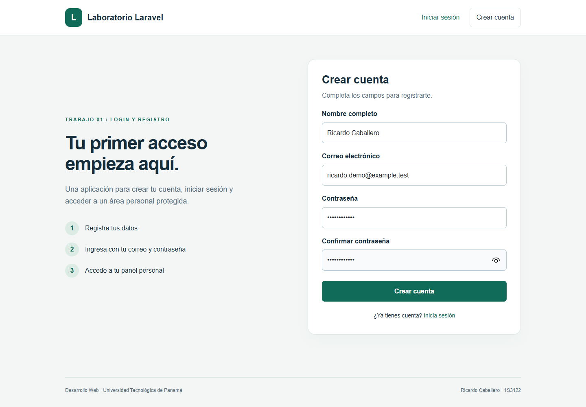
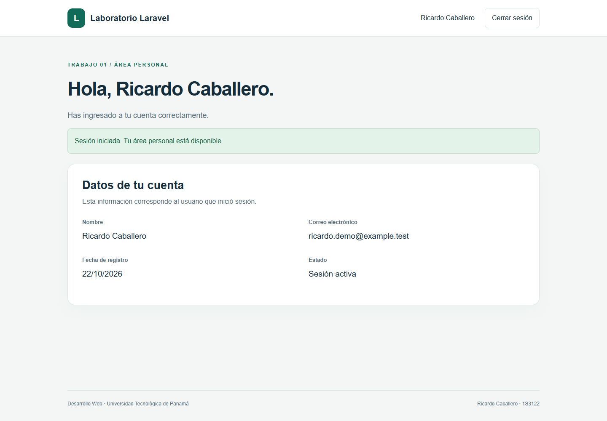
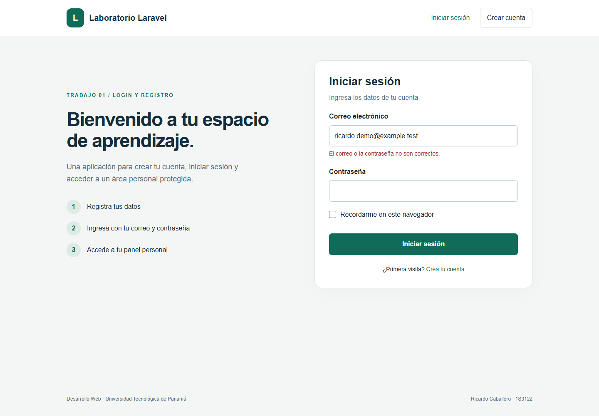

# Trabajo 02 | Documentación del laboratorio

**Estudiante:** Ricardo Caballero  
**Correo académico:** ricardo.caballero5@utp.ac.pa  
**Grupo:** 1S3122  
**Curso:** Desarrollo Web  
**Docente:** Ing. Irina Fong  
**Institución:** Universidad Tecnológica de Panamá, Facultad de Ingeniería de Sistemas Computacionales, Campus Victor Levi Sasso.  
**Fecha de ejecución:** 22 de octubre de 2026.

**Fecha límite indicada en la consigna:** 16 de octubre de 2026. La fecha real de ejecución de esta entrega es 22 de octubre de 2026; no se sustituye por la fecha límite.

## Repositorio del trabajo

https://github.com/ricardo-caballero2663/ricardo-caballero-laravel

## Introducción

Esta entrega documenta la implementación de un módulo de login y registro en Laravel. Su objetivo es registrar los requisitos, la estructura MVC, los comandos, la conexión con la base de datos, los resultados visibles y las dificultades resueltas. El README constituye el documento principal solicitado en la tarea; este PDF ofrece una versión de lectura y presentación.

Es un trabajo documental independiente. El código que describe corresponde al proyecto del trabajo 01; para facilitar una entrega individual, se incluye una copia de sus fuentes en `codigo-login.zip`, además de capturas y un respaldo dentro de esta carpeta. No es necesario entregar el CRUD junto con este informe.

## Requisitos previos y tecnologías


- Sistema operativo utilizado: Windows.
- PHP: 8.3.36 en la ejecución; mínimo 8.2 para Laravel 12. Se comprobó que el PHP de XAMPP era 8.0.30 y se eligió un runtime portátil compatible.
- Laravel: 12.70.1; Composer administra las dependencias PHP y `composer.lock` fija sus versiones.
- Autenticación: `laravel/ui` 4.6.3, con Bootstrap.
- Base de datos: MariaDB 10.4.32, motor InnoDB, base `lab_login`, puerto 3308.
- Servidor web usado: servidor de desarrollo de PHP. XAMPP aporta los binarios de MariaDB; Apache no fue necesario para esta ejecución.
- Node.js y npm: necesarios para instalar y compilar el frontend con Vite. No se deja ese requisito en blanco porque sí se utilizó.
- Editor recomendado para revisar las fuentes: Visual Studio Code.

## Estructura MVC y objetivo del laboratorio

El objetivo práctico es que un usuario pueda registrarse, iniciar sesión, acceder a un panel privado y cerrar su sesión. MVC distribuye las responsabilidades: el modelo representa los usuarios y la persistencia; el controlador procesa la petición; la vista construye la interfaz. Las rutas conectan las URL con los controladores.

```text
app/Models/User.php                Modelo de usuario
app/Http/Controllers/Auth/         Registro y login
app/Http/Controllers/HomeController.php
resources/views/auth/             Formularios Blade
resources/views/home.blade.php     Panel privado
routes/web.php                    Rutas HTTP
database/migrations/              Estructura de tablas
public/build/                     Recursos compilados
```


## Secuencia de comandos y código implementado

```powershell
composer create-project laravel/laravel login-registro "12.*"
cd login-registro
composer require laravel/ui
php artisan ui bootstrap --auth
npm install
php artisan key:generate
php artisan config:clear
php artisan migrate
npm run build
php artisan serve --host=127.0.0.1 --port=18081
```

La secuencia anterior expresa los comandos con PHP y Composer disponibles en el PATH. Durante la ejecución se invocaron mediante rutas al runtime portátil. Para reinstalar una copia del proyecto se usa `composer install` y `npm ci`, que respetan los archivos de bloqueo; no se vuelve a generar el scaffold porque sobrescribiría personalizaciones.

```php
Auth::routes(['reset' => false, 'verify' => false]);
Route::get('/home', [HomeController::class, 'index'])
    ->name('home');
```

`Auth::routes()` declara las rutas de autenticación. `HomeController` aplica `auth`. En las vistas, `@csrf` genera el token del formulario y `@error('email')` presenta los mensajes de validación. El registro utiliza las reglas de Laravel UI y almacena la contraseña mediante hash.

## Base de datos y variables de entorno

```dotenv
APP_NAME="Laboratorio Laravel"
APP_ENV=local
APP_KEY=
APP_DEBUG=true
APP_URL=http://127.0.0.1:18081
APP_LOCALE=es
DB_CONNECTION=mysql
DB_HOST=127.0.0.1
DB_PORT=3308
DB_DATABASE=lab_login
DB_USERNAME=root
DB_PASSWORD=
SESSION_DRIVER=file
CACHE_STORE=file
QUEUE_CONNECTION=sync
```

La configuración se toma de `.env` a través de `config/database.php`. `DB_CONNECTION=mysql` es válido para conectar con MariaDB. El puerto 3308 identifica la instancia aislada; en otra instalación debe ajustarse al puerto real. Después de modificar estas variables se ejecuta `php artisan config:clear`.

`php artisan migrate` creó las tablas de usuarios, recuperación de contraseñas, sesiones, caché y colas. Laravel registra las migraciones ejecutadas en `migrations`. No se usó `migrate:fresh` sobre bases existentes. `php artisan migrate:status` permite inspeccionar el estado sin borrar datos.

### Respaldo y comprobación

El archivo `respaldo/lab_login.sql` es una exportación real de MariaDB con estructura y datos de demostración. El archivo `respaldo/verificacion.txt` registra las tablas y el usuario de prueba, omitiendo la columna de contraseña en ese reporte legible. El SQL contiene el hash necesario para restaurar la cuenta ficticia.

```powershell
mysqldump -h 127.0.0.1 -P 3308 -u root --single-transaction --result-file=lab_login.sql lab_login
```

Para comprobar una restauración, crea una base diferente y vacía. En el cliente MariaDB ejecuta:

```sql
CREATE DATABASE lab_login_revision
  CHARACTER SET utf8mb4 COLLATE utf8mb4_unicode_ci;
USE lab_login_revision;
SOURCE C:/ruta/al/respaldo/lab_login.sql;
SHOW TABLES;
SELECT id, name, email FROM users;
```

La opción `--result-file` evita problemas de codificación de redirecciones de consola en Windows. El respaldo solo debe importarse en una base de práctica vacía. Las sesiones activas se almacenan en archivos y no forman parte del SQL.

## Resultados visibles

Las imágenes proceden de la ejecución local documentada. El correo `ricardo.demo@example.test` es ficticio y permite repetir las pruebas sin usar una cuenta personal real.



El formulario solicita nombre, correo, contraseña y confirmación. Después de enviarlo se crea el usuario.



El panel muestra la información de la cuenta autenticada. Este es el resultado visible solicitado en la consigna.



La aplicación rechaza una contraseña inválida. Al cerrar sesión y volver a solicitar el panel, redirige al formulario de acceso.

## Dificultades encontradas y soluciones

1. PHP incompatible: el entorno existente tenía PHP 8.0.30. Se preparó PHP 8.3.36 portátil y se habilitaron las extensiones necesarias, incluyendo `pdo_mysql`, `mbstring`, `openssl`, `fileinfo`, `curl` y `zip`.
2. Manifiesto Vite ausente antes de compilar: una prueba del panel devolvió error 500. Se ejecutó `npm run build` y luego la misma prueba pasó.
3. Inicio del servidor desde una carpeta incorrecta: el router de desarrollo buscaba `index.php` fuera de `public/`. Se corrigió la carpeta de ejecución y se verificaron las páginas en el navegador.
4. Avisos Sass: Bootstrap produjo advertencias de funciones deprecadas. La compilación terminó correctamente; se registran como advertencias y no como errores de ejecución.

No se inventan otros incidentes de credenciales ni de longitud de índices: esas dificultades aparecen como ejemplos en la consigna, pero no se presentaron en esta base.

## Verificación y conclusión

El proyecto de login superó siete pruebas automatizadas, con 22 aserciones. También se comprobó en el navegador el registro, el acceso correcto, el rechazo de credenciales incorrectas, el cierre de sesión y el bloqueo del panel sin autenticación. La evidencia muestra una implementación funcional y permite relacionar la interfaz con las rutas, controladores y modelo que la soportan.

La documentación facilita instalar, revisar y reproducir el laboratorio. El README, el respaldo y las capturas se mantienen juntos para que la entrega conserve su contexto. El repositorio reúne las fuentes, la documentación y las evidencias del laboratorio.

## Fuentes

Consigna “Tarea Documentar el Laboratorio de Laravel”, Ing. Irina Fong, cinco páginas; y guía de laboratorio de Laravel, 9 de octubre de 2026.

- Laravel 12, instalación: https://laravel.com/docs/12.x/installation
- Laravel 12, estructura: https://laravel.com/docs/12.x/structure
- Laravel 12, migraciones: https://laravel.com/docs/12.x/migrations
- Laravel UI, paquete y compatibilidad: https://github.com/laravel/ui
- Laravel 12, validación: https://laravel.com/docs/12.x/validation

## Paso a paso final: reproducir esta documentación

1. Descomprime `codigo-login.zip` en una carpeta independiente y entra en `aplicacion/`.
2. Instala las dependencias con `composer install` y `npm ci`. Copia `.env.example` a `.env`, configura una base nueva y ejecuta `php artisan key:generate`.
3. Elige una sola forma de preparar la base: `php artisan migrate` para comenzar vacía, o importa `respaldo/lab_login.sql` en una base vacía para recuperar la demostración.
4. Ejecuta `php artisan config:clear`, `npm run build` y `php artisan serve --port=18081`.
5. Repite el registro y el login en el navegador. Si restauraste el SQL puedes ingresar con `ricardo.demo@example.test` y `Laravel2026!`.
6. Toma capturas del registro, del panel y de una validación. Guarda los PNG en `capturas/` y conserva enlaces relativos en `README.md`.
7. Ejecuta `php artisan test` y `php artisan migrate:status`. Anota solo dificultades realmente observadas y sus soluciones.
8. Exporta la base con `mysqldump --result-file`, revisa que incluya únicamente datos de práctica y guarda el SQL en `respaldo/`.
9. Verifica la portada, el grupo, el correo, la fecha real y las referencias. Abre el README y el PDF para comprobar que las imágenes se vean bien.
10. Presenta esta carpeta como trabajo individual. Incluye el enlace del repositorio en la entrega académica.

Este laboratorio ha sido desarrollado para el estudiante de la Universidad Tecnológica de Panamá:

- Nombre: Ricardo Caballero.
- Correo: ricardo.caballero5@utp.ac.pa.
- Curso: Desarrollo Web. Grupo: 1S3122.
- Instructor del laboratorio: Ing. Irina Fong.
