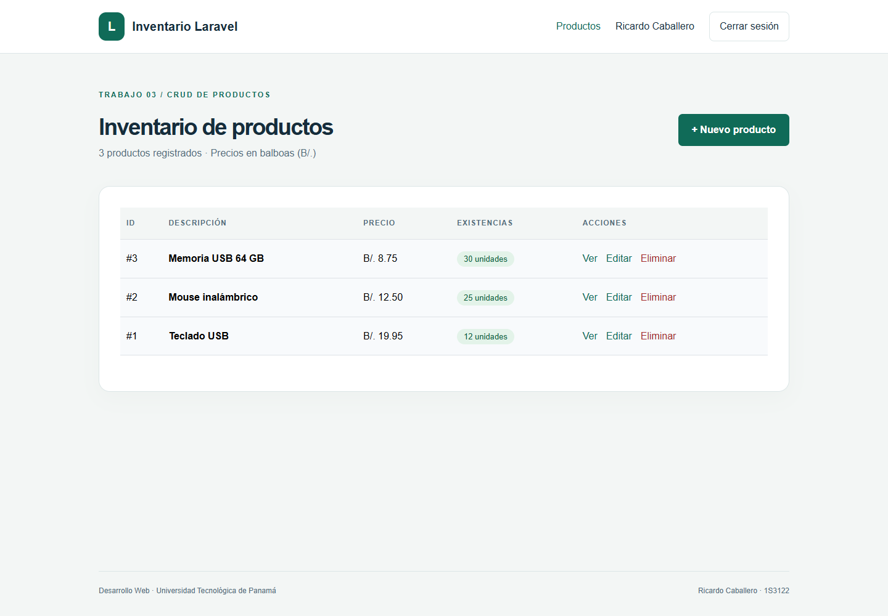
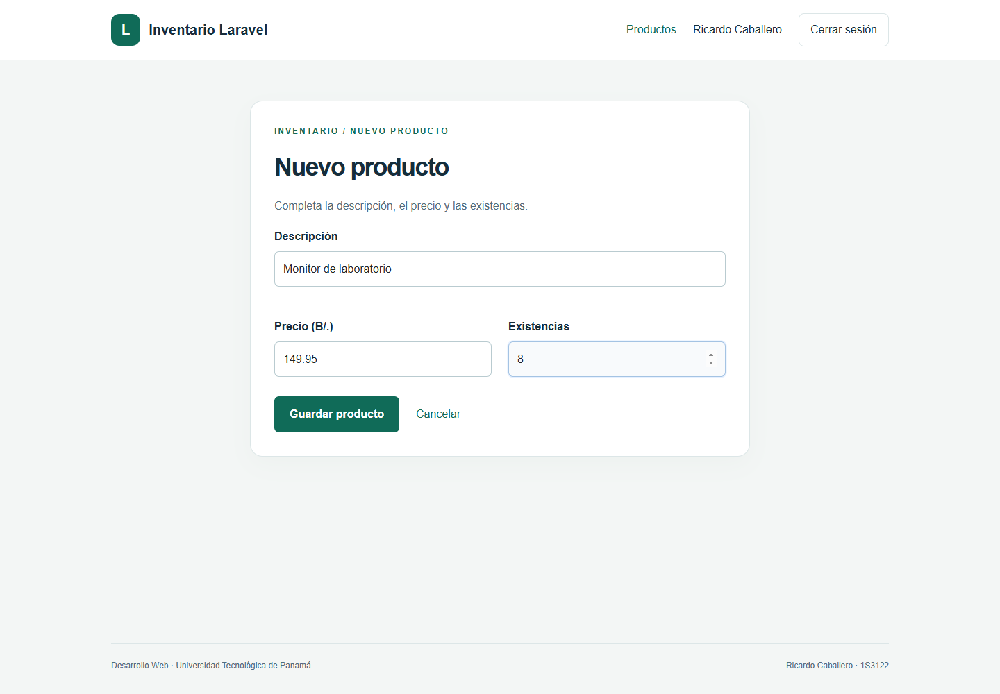
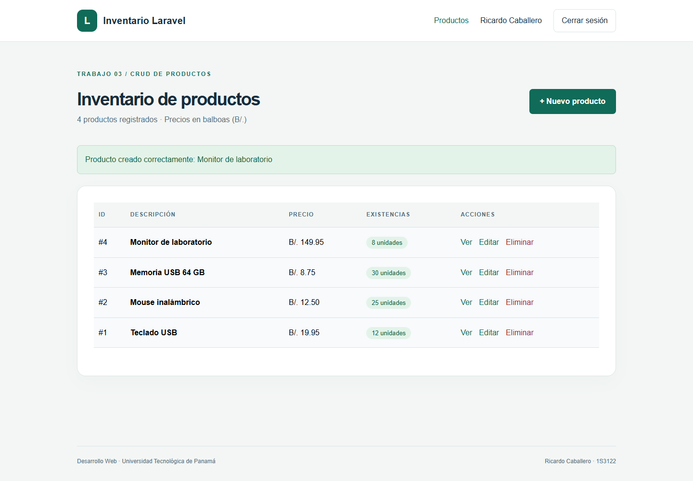
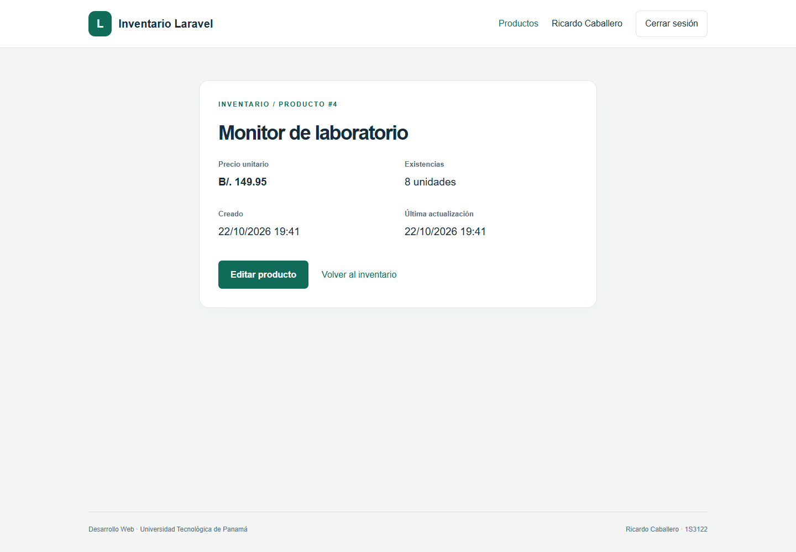
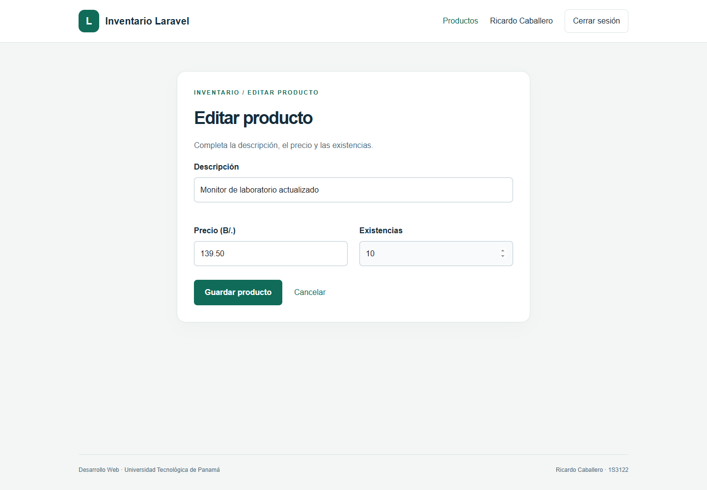
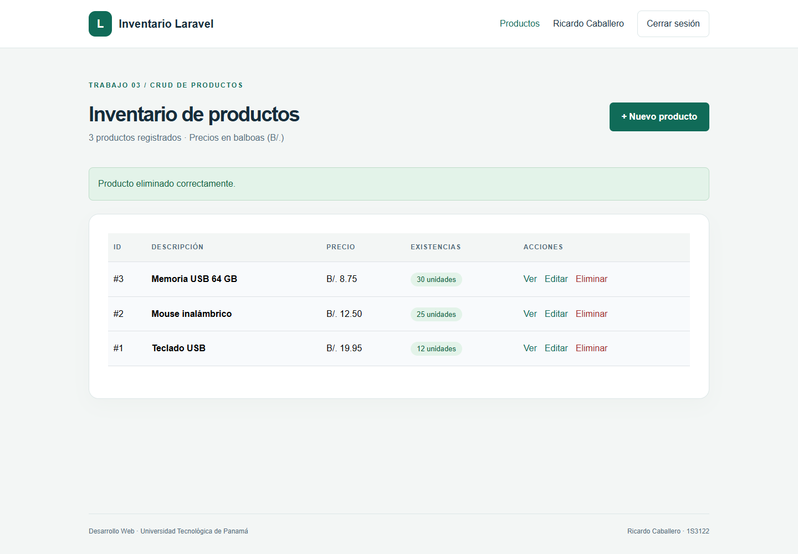
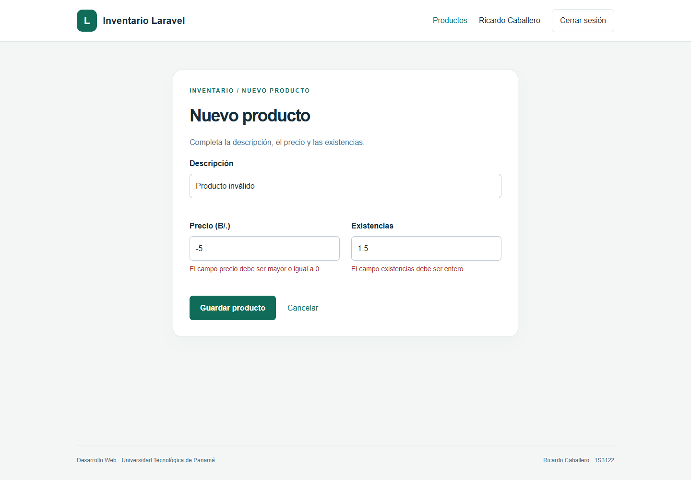

# Trabajo 03 | CRUD de productos en Laravel

**Estudiante:** Ricardo Caballero  
**Correo académico:** ricardo.caballero5@utp.ac.pa  
**Grupo:** 1S3122  
**Curso:** Desarrollo Web  
**Docente:** Ing. Irina Fong  
**Institución:** Universidad Tecnológica de Panamá, Facultad de Ingeniería de Sistemas Computacionales, Campus Victor Levi Sasso.  
**Fecha de ejecución:** 22 de octubre de 2026.

## Repositorio del trabajo

https://github.com/ricardo-caballero2663/ricardo-caballero-laravel

## Introducción y objetivo

Este trabajo implementa un inventario que permite crear, consultar, actualizar y eliminar productos. Sigue el flujo de la presentación “CRUD de Laravel” y utiliza Laravel 12, MariaDB, el generador `ibex/crud-generator` y vistas Blade con Bootstrap. Su objetivo es conectar una tabla de productos con un modelo, un controlador y formularios funcionales.

El proyecto de `aplicacion/` es independiente del login del trabajo 01: utiliza su propia configuración, base `lab_crud`, cookie de sesión y puerto 18083. Incluye autenticación para limitar la administración de productos a usuarios registrados. Los usuarios autenticados comparten el inventario de esta práctica; no se implementan roles ni inventarios por persona.

## Entorno y estructura MVC

Se utilizó PHP 8.3.36, Laravel 12.70.1, MariaDB 10.4.32, laravel/ui 4.6.3 e ibex/crud-generator 2.1.9. El esquema se creó mediante migraciones. Los recursos Bootstrap fueron compilados con Vite y están disponibles en `public/build/`.

- Modelo: `app/Models/Product.php`.
- Controlador: `app/Http/Controllers/ProductController.php`.
- Rutas: `routes/web.php`.
- Vistas: `resources/views/product/`.
- Migración: `database/migrations/2026_10_22_000001_create_products_table.php`.
- Datos iniciales: `database/seeders/DatabaseSeeder.php`.
- Pruebas: `tests/Feature/ProductCrudTest.php`.


## Base de datos y migración

La tabla `products` contiene un identificador, una descripción, un precio, existencias y marcas de tiempo. Se usa `decimal(8,2)` para representar importes de forma exacta: ocho dígitos en total, de los cuales dos son decimales. El máximo positivo es 999999.99. Las existencias son enteras y no negativas.

```php
Schema::create('products', function (Blueprint $table) {
    $table->id();
    $table->string('description');
    $table->decimal('price', 8, 2);
    $table->unsignedInteger('stock');
    $table->timestamps();
});
```

Se corrigió la propuesta `double('price',8,2)` de las diapositivas: para dinero se eligió decimal y se precisó que el ocho indica los dígitos totales, no ocho enteros más dos decimales. La conexión utiliza `DB_DATABASE=lab_crud`, `DB_PORT=3308` y `DB_CONNECTION=mysql`.

## Generación y adaptación del CRUD

```powershell
php artisan make:model Product -m
# Editar la migración con los campos del producto.
php artisan migrate
composer require ibex/crud-generator --dev
php artisan vendor:publish --tag=crud
php artisan make:crud products bootstrap
```

El primer comando muestra el flujo de creación inicial explicado en la presentación. En la entrega la migración y el modelo ya están incluidos: no se debe volver a ejecutarlo sobre el proyecto terminado. El generador se ejecutó realmente contra la tabla `products`; luego se adaptaron el controlador y las vistas para validar datos, mostrar mensajes en español y proteger las rutas.

La versión instalada del generador solicita el tipo de interfaz. Por eso se especifica `bootstrap` después de `products`. La publicación copia su configuración a `config/crud.php`. Regenerar el CRUD sobre la entrega final puede sobrescribir sus personalizaciones.

### Modelo y asignación masiva

```php
class Product extends Model {
    protected $fillable = ['description', 'price', 'stock'];
    protected function casts(): array {
        return ['price' => 'decimal:2', 'stock' => 'integer'];
    }
}
```

`$fillable` enumera los atributos que pueden asignarse en bloque. No autoriza valores arbitrarios: la validación del controlador debe revisar también su contenido. `$guarded` expresa el conjunto de atributos protegidos. Para permitir todos los atributos se usaría `$guarded = []`, no `$fillable = ['*']`; esa alternativa no se utiliza aquí.

### Rutas y responsabilidades del controlador

```php
Route::resource('products', ProductController::class)
    ->middleware('auth');
```

- GET `/products`: `index`, lista paginada.
- GET `/products/create`: `create`, formulario nuevo.
- POST `/products`: `store`, valida y crea.
- GET `/products/{product}`: `show`, presenta el detalle.
- GET `/products/{product}/edit`: `edit`, muestra datos para modificar.
- PUT/PATCH `/products/{product}`: `update`, valida y guarda cambios.
- DELETE `/products/{product}`: `destroy`, elimina y confirma el resultado.

El enlace de modelos resuelve cada identificador de producto; un identificador inexistente devuelve 404. `store` y `update` aceptan exclusivamente los datos devueltos por la validación. Los formularios incluyen `@csrf`; las actualizaciones y eliminaciones usan `@method('PUT')` y `@method('DELETE')`.

### Reglas de validación

```php
return $request->validate([
  'description' => ['required', 'string', 'max:255'],
  'price' => ['required', 'numeric', 'min:0',
              'max:999999.99', 'decimal:0,2'],
  'stock' => ['required', 'integer', 'min:0',
              'max:2147483647'],
]);
```

Las restricciones del navegador ayudan al usuario, pero el servidor verifica las reglas aunque se omitan las restricciones HTML. El precio y las existencias admiten cero. El listado escapa las descripciones y presenta precios con dos decimales. Antes de eliminar se solicita confirmación en el navegador.

## Evidencias del ciclo completo

Las capturas siguientes provienen del CRUD funcionando contra MariaDB. Los productos son de demostración. Se creó un monitor, se modificó y se eliminó para verificar las cuatro operaciones sin alterar los tres productos iniciales.
















## Pruebas, dificultades y conclusiones

El proyecto pasó doce pruebas automatizadas con 45 aserciones. Incluyen el flujo de autenticación, el ciclo completo de un producto, el rechazo de precio negativo y existencias fraccionarias, la aceptación de ceros, el acceso restringido y la respuesta 404. Las pruebas aisladas utilizan SQLite en memoria; las capturas y el respaldo corresponden a MariaDB.

Durante la preparación, el generador solicitó seleccionar una interfaz y se repitió con `bootstrap` explícito. Además, una vista Blade presentó un error de sintaxis por directivas contiguas; se separaron, se limpió la caché de vistas y se repitieron las pruebas hasta que todas pasaron. Los errores tipográficos `Shema`, `defaultStringLenght` y `boostrap` se reemplazaron por `Schema`, `defaultStringLength` y `bootstrap` en la explicación de los comandos.

No fue necesario reducir la longitud predeterminada de cadenas a 191. Tampoco se ejecutó `migrate:fresh`, porque elimina las tablas de la conexión. Las migraciones ordinarias bastaron para una base nueva. No se mezclaron Breeze y Laravel UI: se mantuvo Bootstrap con UI para conservar una sola configuración del frontend.

El resultado demuestra cómo Eloquent, las rutas resource y Blade convierten el esquema de productos en una aplicación completa. La validación evita persistir datos inválidos, mientras que los mensajes y las capturas permiten comprobar cada cambio.

## Respaldo

`respaldo/lab_crud.sql` contiene la exportación real del esquema y los datos finales de práctica. Incluye los tres productos iniciales y la cuenta ficticia usada en las capturas. `respaldo/verificacion.txt` registra los productos existentes después de completar el ciclo.

```powershell
mysqldump -h 127.0.0.1 -P 3308 -u root --single-transaction --result-file=lab_crud.sql lab_crud
```

## Fuentes

Presentación “CRUD de Laravel”, Ing. Irina Fong, 47 diapositivas, proporcionada para el laboratorio.

- Laravel 12, instalación: https://laravel.com/docs/12.x/installation
- Laravel 12, estructura: https://laravel.com/docs/12.x/structure
- Laravel 12, migraciones: https://laravel.com/docs/12.x/migrations
- Laravel UI, paquete y compatibilidad: https://github.com/laravel/ui
- Laravel 12, validación: https://laravel.com/docs/12.x/validation

- Generador CRUD utilizado: https://github.com/awais-vteams/laravel-crud-generator
- Laravel 12, controladores resource: https://laravel.com/docs/12.x/controllers
- Laravel 12, Eloquent y asignación masiva: https://laravel.com/docs/12.x/eloquent

## Paso a paso final: ejecutar y capturar el CRUD

1. Entra en `aplicacion/` y ejecuta `composer install` y `npm ci`. Usa PHP 8.2 o superior y copia `.env.example` a `.env` si es una instalación nueva.
2. Crea la base `lab_crud` en MariaDB. Ajusta los valores de conexión en `.env`; el puerto usado aquí es 3308. Ejecuta `php artisan key:generate` y `php artisan config:clear`.
3. Ejecuta `php artisan migrate` y `php artisan db:seed`. Como alternativa, importa `respaldo/lab_crud.sql` en una base vacía; no necesitas sembrar otra vez si ya restauraste los datos.
4. Ejecuta `npm run build` y `php artisan serve --host=127.0.0.1 --port=18083`. Abre `http://127.0.0.1:18083`.
5. Registra una cuenta nueva, o usa la del respaldo: `ricardo.demo@example.test` y `Laravel2026!`. Entra a Productos y captura el inventario.
6. Pulsa Nuevo producto; escribe una descripción, un precio y existencias. Captura el formulario y guarda. Captura el mensaje y el producto nuevo.
7. Pulsa Ver para capturar el detalle. Después pulsa Editar, cambia sus datos y captura el formulario y el resultado guardado.
8. Pulsa Eliminar sobre el producto de prueba y confirma. Captura el mensaje de eliminación y comprueba que ya no aparezca.
9. Verifica que no se admitan importes negativos ni existencias fraccionarias. Ejecuta `php artisan test` y consulta `php artisan route:list --path=products`.
10. Genera el respaldo actualizado y conserva las imágenes en `capturas/`. Presenta este trabajo de forma independiente con su informe y sus fuentes.

Este laboratorio ha sido desarrollado para el estudiante de la Universidad Tecnológica de Panamá:

- Nombre: Ricardo Caballero.
- Correo: ricardo.caballero5@utp.ac.pa.
- Curso: Desarrollo Web. Grupo: 1S3122.
- Instructor del laboratorio: Ing. Irina Fong.
